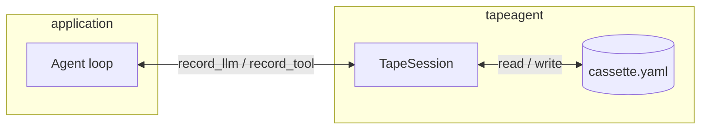
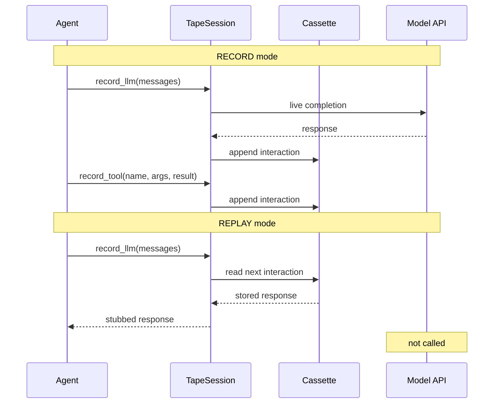
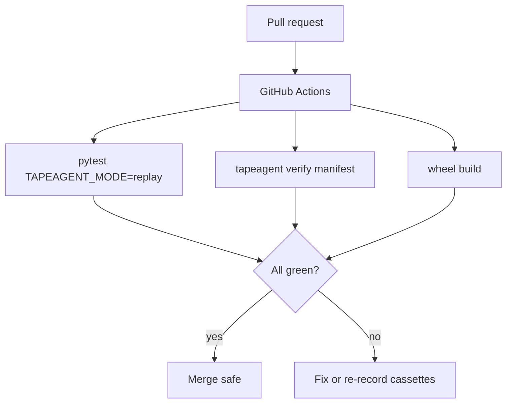

# TapeAgent

[](https://github.com/Jay2006sawant/tapeagent/actions/workflows/ci.yml)


**Record–replay regression testing for tool-using agents** (a VCR-style workflow for multi-step agent runs).

TapeAgent captures each model call and tool invocation in a versioned YAML **cassette**, replays that trace in CI without live API access, and fails when tool order, arguments, or stored responses drift. It targets the gap between brittle mocks and expensive, flaky live tests.

Repository: [github.com/Jay2006sawant/tapeagent](https://github.com/Jay2006sawant/tapeagent)

---

## Table of contents

- [Problem](#problem)
- [Solution](#solution)
- [System overview](#system-overview)
- [Cassette format](#cassette-format)
- [Operating modes](#operating-modes)
- [Installation](#installation)
- [Quick start](#quick-start)
- [Usage patterns](#usage-patterns)
- [CLI reference](#cli-reference)
- [CI and verification](#ci-and-verification)
- [Repository layout](#repository-layout)
- [Design tradeoffs](#design-tradeoffs)
- [Roadmap](#roadmap)
- [Contributing](#contributing)
- [License](#license)

---

## Problem

Tool-using agents are multi-step programs: the model proposes tools, your code executes them, results go back to the model, and the loop continues. When you change prompts, parsers, or model versions, behavior can shift silently—extra tool calls, different argument shapes, or swapped reasoning paths—while unit tests that mock a single step still pass.

Teams need:

1. **Integration-level** traces, not isolated mocks.
2. **Deterministic CI** without paying for model APIs on every push.
3. **Actionable diffs** when behavior regresses (tool sequence, request hashes, optional text compare).

TapeAgent addresses all three.

---

## Solution

| Capability | Description |
|------------|-------------|
| **Record** | Persist ordered interactions (model + tools) to `*.yaml` cassettes. |
| **Replay** | Feed stored responses back to the agent; live clients are not called. |
| **Diff** | Compare two runs—especially tool sequences and interaction counts. |
| **Verify** | Manifest-driven batch replay for pipelines. |
| **Pytest** | `@pytest.mark.tape` fixture for scenario tests. |

---

## System overview

### High-level data flow



### Record vs replay



### CI pipeline



---

## Cassette format

A cassette file holds one or more **named runs**. Each run is an ordered list of **interactions**:

| Kind | Stored fields | Purpose |
|------|----------------|---------|
| `llm` | `request` (messages, params), `response` (content, tool_calls), `request_hash` | Match model turns on replay |
| `tool` | `request` (arguments), `response.result`, `request_hash` | Match tool calls on replay |

Request hashes detect argument drift without diffing entire JSON blobs. Example structure:

```yaml
schema_version: 1
runs:
  weather_query:
    name: weather_query
    interactions:
      - kind: llm
        name: mock-llm
        request: { messages: [...] }
        response: { content: "", tool_calls: [...] }
      - kind: tool
        name: get_weather
        request: { city: Pune }
        response: { result: { city: Pune, temp_c: 32 } }
```

Committed demos live in `src/tapeagent/demo/cassettes/`.

---

## Operating modes

| Mode | How to set | Behavior |
|------|------------|----------|
| `AUTO` | Default in code | Record if cassette missing; else replay |
| `RECORD` | `TAPEAGENT_MODE=record` | Always write/update cassette |
| `REPLAY` | `TAPEAGENT_MODE=replay` | Strict replay; mismatch raises |

Use **AUTO** locally while developing; set **REPLAY** in CI.

---

## Installation

**Requirements:** Python 3.10+

```bash
git clone https://github.com/Jay2006sawant/tapeagent.git
cd tapeagent
python3 -m venv .venv
source .venv/bin/activate   # Windows: .venv\Scripts\activate
pip install -U pip
pip install -e ".[dev]"
```

Optional OpenAI client integration:

```bash
pip install -e ".[openai]"
```

---

## Quick start

```bash
make install    # venv + editable install
make test       # pytest in replay mode
make verify     # manifest-based scenarios
make demo       # reference agent
```

Record after intentional behavior changes:

```bash
make record
git add src/tapeagent/demo/cassettes/
```

---

## Usage patterns

### 1. Context manager

```python
from pathlib import Path
from tapeagent import TapeMode, tape

with tape("checkout_flow", cassette_dir=Path("cassettes"), mode=TapeMode.AUTO) as session:
    response = session.record_llm({"messages": [...]}, live_response, model="gpt-4o-mini")
    data = session.record_tool("fetch_order", {"id": "42"}, {"status": "shipped"})
```

### 2. LLM wrapper

```python
from tapeagent import TapedLLM, tape

def my_provider(messages, *, model, **kwargs):
    ...

with tape("scenario_a") as session:
    llm = TapedLLM(session, my_provider)
    out = llm.complete([{"role": "user", "content": "..."}])
```

### 3. OpenAI-shaped client

```python
from tapeagent import TapedOpenAI, tape

with tape("support_flow") as session:
    wrapped = TapedOpenAI(session, openai_client)
    wrapped.chat.completions.create(
        model="gpt-4o-mini",
        messages=[{"role": "user", "content": "..."}],
    )
```

### 4. Pytest

```python
import pytest
from tapeagent.demo.simple_agent import run_agent

@pytest.mark.tape("weather_query", cassette_dir="tests/fixtures/cassettes", mode="replay")
def test_weather(tape_session):
    answer = run_agent("What's the weather in Pune?", tape_session)
    assert "Pune" in answer or "tool output" in answer
```

### 5. Verification manifest

`examples/verify_manifest.yaml`:

```yaml
scenarios:
  - name: weather_query
    cassette_dir: ../src/tapeagent/demo/cassettes
    entrypoint: tapeagent.demo.simple_agent:run_weather_scenario
```

```bash
tapeagent verify examples/verify_manifest.yaml
```

---

## CLI reference

| Command | Description |
|---------|-------------|
| `tapeagent show <cassette.yaml> <run_name>` | Print interaction table |
| `tapeagent diff <baseline> <candidate> <run_name> [--json]` | Compare two cassettes |
| `tapeagent verify <manifest.yaml>` | Replay all manifest scenarios |

---

## CI and verification

The workflow [`.github/workflows/ci.yml`](.github/workflows/ci.yml) runs on Python 3.10–3.12:

1. `pytest` with `TAPEAGENT_MODE=replay`
2. `tapeagent verify examples/verify_manifest.yaml`
3. `python -m build` (packaging smoke test)

Reuse in other repositories via [`.github/actions/tapeagent-verify`](.github/actions/tapeagent-verify/action.yml).

Portfolio and demo checklist: [`docs/SHOWCASE.md`](docs/SHOWCASE.md).

---

## Repository layout

```text
tapeagent/
├── src/tapeagent/
│   ├── cassette.py      # Schema, load/save, hashing
│   ├── session.py       # TapeSession, tape(), modes
│   ├── llm.py           # TapedLLM
│   ├── openai_shim.py   # TapedOpenAI
│   ├── diff.py          # compare_runs
│   ├── verify.py        # Manifest runner
│   ├── pytest_plugin.py # @pytest.mark.tape
│   ├── cli.py           # Console entry point
│   └── demo/            # Reference agent + cassettes
├── tests/               # Unit and integration tests
├── examples/            # Demo entry script + verify manifest
├── docs/                # Architecture, showcase
├── Makefile
└── pyproject.toml
```

Deeper design notes: [`docs/architecture.md`](docs/architecture.md).

---

## Reference agent (demo)

`tapeagent.demo.simple_agent` is a **deterministic specimen**:

- Mock model logic chooses `get_weather` vs `search_docs`.
- Tools return fixed payloads.
- Cassettes ship with the package so CI spends **zero** on external APIs.

Replace the mock with your provider inside `TapedLLM` / `TapedOpenAI`, record once, commit cassettes, replay forever in CI.

---

## Design tradeoffs

| Choice | Rationale |
|--------|-----------|
| YAML cassettes | Human-readable, diffable in PRs |
| Request hashes | Fast failure on argument drift |
| Replay stubs model output | CI stability; not a substitute for accuracy evals |
| No network in verify | Predictable, credential-free pipelines |

**Limitations:** Replays store prior model text; it does not make live models deterministic. Pair TapeAgent with a labeled eval set when measuring answer quality.

---

## Roadmap

- [x] Core record/replay session
- [x] Pytest plugin and CLI (`show`, `diff`, `verify`)
- [x] OpenAI chat completions shim
- [x] GitHub Actions + composite verify action
- [ ] PyPI release
- [ ] Optional fuzzy text diff for final assistant messages

---

## Contributing

See [CONTRIBUTING.md](CONTRIBUTING.md). After changing agent behavior: `make record`, run `make test` and `make verify`, commit updated cassettes.

---

## License

MIT © Jay Sawant — see [LICENSE](LICENSE).
